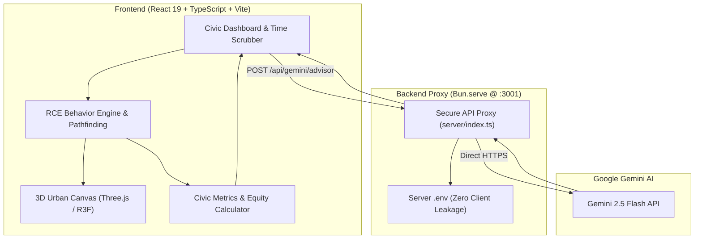

# 🏙️ CivicTwin — Agentic Urban Policy Digital Twin & Impact Forecasting

[](https://opensource.org/licenses/MIT)
[](https://react.dev/)
[](https://threejs.org/)
[](https://ai.google.dev/)
[](https://bun.sh/)
[](https://www.typescriptlang.org/)

> **"Don't experiment on real citizens. Simulate first."**  
> **CivicTwin** is an autonomous agent-based digital twin that models neighborhood dynamics, human vulnerability, and civic infrastructure. Test urban interventions—such as streetlights, night bus routes, and public restrooms—and forecast perceived safety, demographic equity, economic ROI, and unintended side-effects **before** spending millions on asphalt and concrete.

---

## 🌟 Why CivicTwin?

In conventional municipal governance, policy changes are tested in production on actual citizens. When a city implements a bus route cut, alters streetlight grids, or plans public facilities, the actual consequences often emerge months later as civil complaints, decreased safety for vulnerable groups, and wasted municipal budgets.

**CivicTwin** pivots agent simulation frameworks into a civic digital twin:
- **Shoppers ➡️ Diverse Citizens**: Single mothers, elderly residents with limited mobility, night-shift nurses, university students, and local authorities.
- **Retail Aisles ➡️ Urban Micro-districts**: Roads, dark alley corridors, transit stops, parks, schools, clinics, and residential hubs.
- **Conversion Rates ➡️ Civic Vitality Metrics**: Perceived safety indexes, demographic equity scores, transit accessibility, and unintended side-effects.

---

## ✨ Key Features

### 🗺️ Locality Home & Neighborhood Designer
- Start from a locality dashboard featuring the Maplewood sample, or build and save your own neighborhood.
- Arrange a 16 × 16 locality map by placing homes, shops, schools, clinics, transit hubs, parks, roads, sidewalks, open space, and dark areas.
- Saved localities stay in this browser and open directly in the existing simulation with synthetic residents generated from placed homes.

### 1. 🌆 Real-Time 3D Spatial Micro-District
- Fully interactive Three.js & React Three Fiber urban canvas with real-time 24-hour diurnal lighting cycles.
- Dynamic road networks with dual-lane dividers, crosswalks, pedestrian zones, and lush public parks.
- Physics-accurate illumination: Streetlights project real dual-ring volumetric golden light cones onto dark corridors.

### 2. 🧠 3-Stage RCE (Routine-Choice-Environmental) Agent Engine
- **Routine Execution**: Autonomous citizen schedules generated deterministically across all 24 hours.
- **Discrete Destination Choice**: Gravity-based utility modeling accounting for travel time, purpose, and physical safety.
- **Dynamic Environmental Reaction**:
  - Dark Corridor Penalty: Vulnerable agents incur exponential fear penalties when traversing unlit areas at night, prompting detours or avoidance.
  - Night Bus Hops: High-frequency transit allows citizens to hop routes, bypassing high-risk dark zones.
  - Comfort & Restroom Pitstops: Natural biological and comfort dynamics driving purposeful deviations.

### 3. 🛠️ Interactive Policy Sandbox
Deploy, toggle, and configure civic interventions in real time:
- 💡 **Dual-Corridor Smart Streetlighting**: Illuminates blindspots, cutting night fear penalties by up to 68%.
- 🚌 **Night Owl Transit Route**: Adds scheduled public transit hops directly connecting clinics, residential cores, and commercial strips.
- 🚻 **Sanitation & Restroom Hub**: Increases elderly and family dwell comfort and improves accessibility.
- 🚨 **Emergency SOS Kiosks**: Immediate deterrent and high-visibility response beacons for vulnerable pedestrians.
- 🛑 **Traffic Calming & Speed Bumps**: Discourages speeding near schools and high-foot-traffic parks.

### 4. 📊 Comprehensive Civic Dashboard & A/B Comparison
- **Live Metric Scrubber**: Toggle between **Status Quo (Baseline)**, **Policy Sandbox**, and **Side-by-Side A/B Difference**.
- **Demographic Equity Audit**: Disaggregates safety and accessibility metrics across vulnerable groups (elderly, female solo night commuters, low-mobility citizens).
- **Unintended Consequences Radar**: Automatically detects second-order externalities such as gentrification risk, loitering displacement, and light pollution.
- **Citizen Voice Journals**: Live contextual thought feeds expressing synthetic citizens' emotions, fear spikes, relief, and daily travel reflections.

### 5. 🤖 Secure Gemini 3.8 Flash Policy Consultant
- Real-time deep civic policy analysis powered by Google's `gemini-3.8-flash`.
- Generate executive policy briefs, calculate CapEx/OpEx payback timelines, and evaluate political viability.
- **Zero-Bundle-Leak Architecture**: All AI requests are mediated via a hardened local Bun backend proxy (`server/index.ts`). No API keys are ever bundled or exposed in client assets.

---

## 🏛️ System Architecture



---

## 🚀 Quickstart Guide

### Prerequisites
- [Node.js](https://nodejs.org/) (v18+) or [Bun](https://bun.sh/) (v1.1+)
- Git

### 1. Clone the Repository
```bash
git clone https://github.com/sapandeep31/civictwin.git
cd civictwin
```

### 2. Install Dependencies
```bash
bun install
# or
npm install
```

### 3. Configure Environment Variables
Create a `.env` file in the project root (never committed to git):
```bash
cp .env.example .env
```
Add your Google Gemini API key:
```env
PORT=3001
GEMINI_API_KEY=your_gemini_api_key_here
```

*(Note: The client application will gracefully use rich offline fallback heuristics if no API key is configured).*

### 4. Run the Development Environment

Start the secure backend server:
```bash
bun run server
# or: node server/index.ts
```

In another terminal, start the Vite development server:
```bash
bun run dev
# or: npm run dev
```

Open your browser at **`http://localhost:5173`**.

---

## 📐 Tech Stack

| Domain | Technology |
|---|---|
| **Core Framework** | React 19, TypeScript 5.x |
| **Build & Tooling** | Vite 8, Bun, Oxlint |
| **3D Visualization** | Three.js, React Three Fiber (`@react-three/fiber`), `@react-three/drei` |
| **Styling & Design System** | Custom Glassmorphic Dark UI, Vanilla CSS Tokens, Lucide React |
| **Data Visualization** | Recharts (Responsive charts, Radar charts, Bar breakdowns) |
| **AI Policy Intelligence** | Google Gemini 2.5 Flash via Bun Reverse Proxy |
| **Micro-Interactions** | Canvas-Confetti, CSS Keyframe Animations |

---

## 🔒 Security & Privacy

CivicTwin is engineered with strict secret boundaries:
- **No Client Exposure**: Vite client builds never receive `VITE_` API tokens.
- **Isolated Server Process**: API queries are constructed on the server runtime and sent to `https://generativelanguage.googleapis.com` over authenticated HTTPS.
- **Synthetic Personas**: All citizen behavior data is synthetic and local—no real PII is generated or recorded.

---

## 📜 License

CivicTwin is open-source software licensed under the [MIT License](LICENSE).
